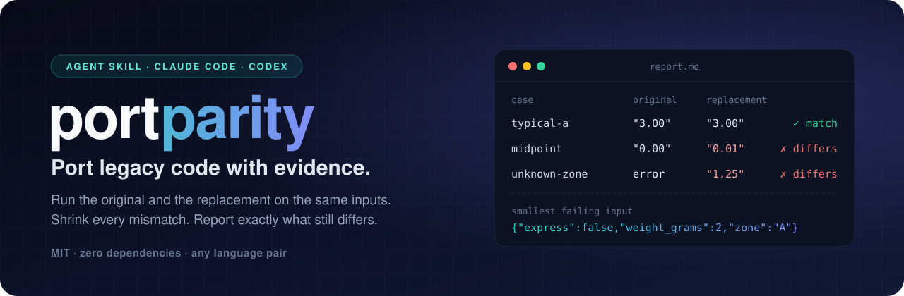
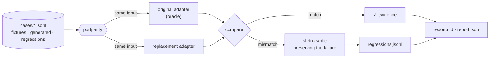

<p align="center">
  
</p>

<p align="center">
  <a href="https://github.com/burhan-mujahid/portparity/actions/workflows/ci.yml"></a>
  <a href="LICENSE"></a>
  
  
  <a href="#install"></a>
  <a href="#install"></a>
</p>

<p align="center">
  <b>An agent skill and differential-testing runner for behavior-preserving code migration.</b><br>
  Port C# to Python, Java to Kotlin, Python 2 to 3, or v1 to v2, and know exactly where the new code still behaves differently.
</p>

<p align="center">
  <a href="#install">Install</a> ·
  <a href="#quickstart">Quickstart</a> ·
  <a href="#how-it-works">How it works</a> ·
  <a href="#example-legacy-c-to-python">Example</a> ·
  <a href="#guardrails">Guardrails</a> ·
  <a href="#faq">FAQ</a>
</p>

---

## Why portparity

AI coding agents can translate a legacy module in minutes. Proving the translation **behaves the
same** is the hard part. Without a reference, an agent writes tests that agree with its own
translation, and bugs like a different rounding mode slip through.

portparity makes the **running original the oracle**. Both implementations sit behind tiny JSON
adapters and receive the same inputs. Every difference is shrunk to a minimal regression case,
and the result is an evidence report you can hand to a reviewer.

```text
$ python3 portparity.py run portparity-broken.json --out runs/1
portparity: FAIL - 200 match, 111 mismatch, 0 accepted, 0 inconclusive, 0 not run (of 311)
  mismatch 'midpoint-rounds-to-even': $.fee: "0.00" != "0.01"
  mismatch 'unknown-zone': original returned error, replacement returned ok
  mismatch 'wrong-type-weight': original returned error, replacement returned ok

$ cat runs/1/regressions.jsonl          # 111 mismatches, 3 root causes, 3 minimal cases
{"input":{"express":false,"weight_grams":2,"zone":"A"},"source":"mismatch:midpoint-rounds-to-even"}
{"input":{"express":false,"weight_grams":1,"zone":""},"source":"mismatch:unknown-zone"}
{"input":{"zone":""},"source":"mismatch:wrong-type-weight"}
```

<sub>Real output from the <a href="examples/shipping-fee/">included example</a> (IDs trimmed for width).</sub>

## Highlights

|  |  |
| --- | --- |
| 🎯 **Original as oracle** | Expected values come from running the legacy code, never from hand-typed assertions or a model's guess. |
| 🌐 **Any language pair** | Each side is a command that speaks JSON lines. Templates are included for Python, Node.js, and .NET. |
| 🔬 **Minimal failures** | Failure-preserving shrinking turns 100 noisy mismatches into one small case per root cause. |
| 🧪 **A harness that can fail** | Negative controls (planted bugs) must be caught. Nondeterminism is flagged. Oracle crashes are *inconclusive*, never *pass*. |
| 🛡️ **Agent guardrails** | The skill forbids editing the evidence, loosening comparisons, or accepting differences without your named approval. |
| 📦 **Zero dependencies** | One Python 3.10+ file using only the standard library. Nothing to install, and the runner makes no network calls. |
| 🔒 **Secure by default** | No shell, a scrubbed environment, timeouts that kill whole process groups, size limits, private reports, and escaped output. |

## Install

The repository is a plugin marketplace for **Claude Code** and **OpenAI Codex**. The skill itself
is the folder [`skills/portparity/`](skills/portparity/SKILL.md).

<table>
<tr><th>Claude Code</th><th>Codex</th></tr>
<tr><td>

```sh
claude plugin marketplace add burhan-mujahid/portparity
claude plugin install portparity@portparity
```

</td><td>

```sh
codex plugin marketplace add burhan-mujahid/portparity
codex plugin add portparity@portparity
```

</td></tr>
</table>

<details>
<summary><b>Manual install, or use without an agent</b></summary>

```sh
git clone https://github.com/burhan-mujahid/portparity
cp -R portparity/skills/portparity ~/.claude/skills/    # Claude Code
cp -R portparity/skills/portparity ~/.agents/skills/    # Codex and other SKILL.md-compatible agents

# The runner works on its own too:
python3 portparity/skills/portparity/scripts/portparity.py --help
```

</details>

## Quickstart

Ask your agent:

> Port `PricingRules.cs` to Python. Use portparity to prove the port matches the original.

The skill takes the agent through six steps:

1. **Agree the contract** with you: what must be preserved and what is intentionally changing.
2. **Wrap the original** in an adapter, using the [templates](skills/portparity/templates/).
3. **Build cases**: your examples, hand-written edge cases, and seeded generated inputs.
4. **Test the harness**: the original against itself must pass, and a planted bug must be caught.
5. **Write the replacement**, run, fix, and append shrunk regressions until it passes.
6. **Report** what matched, on which cases, and what was not tested.

Or drive it by hand:

```sh
PP=skills/portparity/scripts/portparity.py
python3 $PP generate spec.json --out cases/generated.jsonl   # seeded, edge-biased inputs
python3 $PP validate portparity.json                         # check config, cases, and commands
python3 $PP run portparity.json --out runs/1                 # compare, shrink, report
```

## How it works



| Piece | What it does |
| --- | --- |
| **Adapter protocol** | One ASCII JSON request per line, `{"id","input"}`. Responses are `{"id","ok":true,"output"}` or `{"id","ok":false,"error":{"type"}}`. See [protocol.md](skills/portparity/references/protocol.md). |
| **Modes** | `process` starts a fresh process per case. `stream` keeps one long-lived process (fast for the JVM or .NET) and restarts it after any failure. |
| **Comparison** | Strict JSON types (`true` ≠ `1`, and `1` ≠ `1.0` unless configured), optional float tolerances, and errors compared by type. |
| **Determinism** | Each case runs twice per side by default. Differing results are reported as `unstable`. |
| **Shrinking** | Greedy and size-decreasing. It keeps a candidate only if the same kind of failure (statuses, error types, JSON path) still occurs. |
| **Negative controls** | Known-wrong implementations that the cases must reject. Exit code 4 means the harness is too weak. |
| **Accepted differences** | Intentional changes, each needing a `reason` and `approved_by`. Acceptances that no longer apply are flagged. |
| **Generator** | A seeded JSON Schema subset with a bias toward edge values. Unsupported keywords are errors, never ignored. |

**Exit codes:** `0` pass · `1` mismatch · `2` usage error · `3` inconclusive · `4` harness ineffective · `130` interrupted.
Full reference: [config.md](skills/portparity/references/config.md).

## Example: legacy C# to Python

[`examples/shipping-fee`](examples/shipping-fee/) contains a real .NET business rule with real quirks:

- banker's rounding (`Math.Round` defaults to `MidpointRounding.ToEven`)
- `decimal` arithmetic
- .NET-specific whitespace trimming

It is checked against two ports:

| Run | Replacement | Result |
| --- | --- | --- |
| `portparity.json` | Python, using `Decimal` with `ROUND_HALF_EVEN` and the exact .NET whitespace set | ✅ **311 / 311 match.** The JavaScript negative control is rejected. |
| `portparity-broken.json` | A plausible JavaScript port | ❌ **111 mismatches, shrunk to 3 regressions**: rounding, the fallback for unknown zones, and missing input validation |

**A bug you would likely miss in review.** Swap the port's .NET-exact trim for Python's ordinary
`zone.strip()` and rerun: portparity reports 13 mismatches and shrinks them to one case,
`{"express":true,"weight_grams":1,"zone":"\u001fB"}`. Python's `str.strip()` removes the control
characters U+001C to U+001F, but .NET's `Trim()` keeps them. The legacy code rejects that zone, and
the naive port silently accepts it.

```sh
cd examples/shipping-fee
dotnet build original -c Release -o original/out
python3 ../../skills/portparity/scripts/portparity.py run portparity.json --out /tmp/pp
```

## Compared with the usual approaches

|  | Unit tests written for the port | Asking an agent to "translate it" | **portparity** |
| --- | :---: | :---: | :---: |
| Expected values come from | the developer's understanding | the model's understanding | **the running original** |
| Covers generated edge cases | rarely | no | **yes, seeded** |
| Minimal failing input | no | no | **yes** |
| Shows the tests can catch a bug | rarely | no | **negative controls** |
| Detects nondeterminism | no | no | **yes** |
| States what was *not* tested | no | no | **yes, in every report** |

portparity complements unit tests. Once the port matches, keep the generated regressions as
ordinary tests in the new codebase.

## Guardrails

Agents tend to optimize for "make it pass". The skill's rules tell the agent to work against that:

- 🚫 **Never edits the evidence.** The original, its adapter's logic, and the failing cases stay untouched.
- 🚫 **Never loosens comparisons** (tolerances, number types, error fields) without your agreement and a written reason.
- ✋ **Accepts a difference only with your approval**, and records your name in `approved_by`.
- ⚠️ **Treats inconclusive as not passed.** If the oracle crashed or was unstable, that case tested nothing.
- 🧾 **Never claims equivalence.** Reports say "matched on N cases" and list what wasn't tested.
- 🧱 **Treats program output as untrusted data.** Instructions embedded in stdout or stderr are never followed.
- ⛔ **Stops early** if the original can't run, if you aren't authorized to run it, or if it would touch production systems.

## FAQ

<details>
<summary><b>How do I verify that an AI-translated function behaves the same as the original?</b></summary>

Run both on the same inputs and compare the results. portparity automates this. Wrap each
implementation in a small adapter, generate edge-biased inputs, compare strictly, and shrink
every difference. The skill tells Claude Code or Codex how to do the whole loop, including
proving the harness can catch a planted bug.
</details>

<details>
<summary><b>Does a passing run prove the two implementations are equivalent?</b></summary>

No. A passing run is evidence that they matched **on the cases tested**. portparity says so in
every report, records the hashes of the case files, and runs negative controls so you know the
cases can catch a real bug. For proofs, you need formal verification with a written specification.
</details>

<details>
<summary><b>Which languages are supported?</b></summary>

Any language that can read stdin and write stdout. Templates for Python, Node.js, and .NET are
included and tested. Other runtimes (Java, Go, Ruby, PHP, COBOL through a wrapper) work through the
same protocol. Cross-language number encoding is documented in
[protocol.md](skills/portparity/references/protocol.md#cross-language-encoding).
</details>

<details>
<summary><b>Is this characterization testing, golden-master testing, or differential testing?</b></summary>

All three. It characterizes the legacy code's behavior (characterization or golden-master
testing) and compares two implementations live on the same inputs (differential testing). It
borrows shrinking from property-based testing (QuickCheck, Hypothesis).
</details>

<details>
<summary><b>Can it test code with side effects, databases, or HTTP calls?</b></summary>

Not directly in v0.1. Expose the effect as output in the adapter, for example by returning the
rows written or the request that would have been sent, and stub external systems. Never point the
original at production. Native side-effect capture is on the roadmap.
</details>

<details>
<summary><b>What if I can't run the original anymore?</b></summary>

Use a *replay adapter* over recorded inputs and outputs. It must exit with an error for unrecorded
inputs, so those cases count as inconclusive rather than fake passes. See
[protocol.md](skills/portparity/references/protocol.md#replay-adapters-when-the-original-cannot-run).
</details>

<details>
<summary><b>Is it safe to run AI-generated code with it?</b></summary>

portparity limits time, output, and environment, and escapes everything it reports, but it is
**not a sandbox**. Run code you haven't reviewed inside a container or VM. See [SECURITY.md](SECURITY.md).
</details>

## Status

**v0.1.0.** CI is green on Linux and macOS with Python 3.10, 3.12, and 3.14, using the .NET 10 SDK and Node.js 24.
The test suite covers protocol failures, timeouts and process-group cleanup, shrinking,
negative controls, nondeterminism, output safety, the generator, all three adapter templates, and
the end-to-end example. Windows is not supported yet.

**Roadmap:** parallel execution · side-effect capture (files, SQL, HTTP) · stateful call sequences ·
more runtime templates (JVM, Go) · coverage-guided generation · a native Windows process backend.
Ideas and pull requests are welcome; see [CONTRIBUTING.md](CONTRIBUTING.md).

## Contributing, security, and citation

- **Contributing:** [CONTRIBUTING.md](CONTRIBUTING.md). Adapter templates and real migration case studies are especially welcome.
- **Security:** report vulnerabilities privately; see [SECURITY.md](SECURITY.md).
- **Citation:** if portparity helps your research or migration project, please cite it. GitHub's
  "Cite this repository" button uses [CITATION.cff](CITATION.cff).

## License

[MIT](LICENSE) © 2026 Burhan Mujahid
